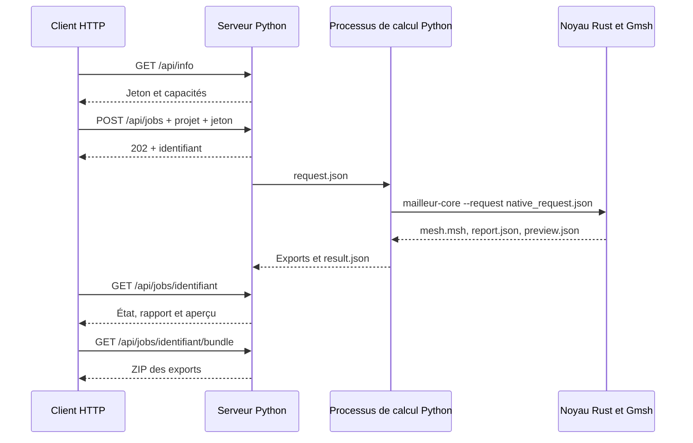

# Utiliser l’API d’Atelier Mailleur

Ce guide décrit le code présent dans ce dépôt, version rc6, avec les contrats de base issus de la rc5. Trois moyens d’intégration existent : le serveur HTTP local, la classe Python `NativeSession`, et le programme Rust `mailleur-core --request`. Ils utilisent le même moteur. L’interface Qt utilise surtout `NativeSession` ; le serveur HTTP fournit aussi une petite interface web.

La rc6 ajoute **`GET /api/formats`**, qui renvoie `imports` et `exports`.
`imports.formats` distingue lecteurs intégrés et formats conditionnels par
`extension`, `kind`, `conditional`, `available`, `converter` et `reason`.
La présence d'une passerelle configurée n'atteste pas qu'elle a été exécutée
avec toutes les versions d'un logiciel. `GET /api/info` contient également
cette découverte sous `import_formats`. La cible 2020+ reste distincte des
versions de solveurs réellement testées.

Les nouvelles sources utilisent les mêmes routes d'upload et de génération.
Les commandes de convertisseur proviennent exclusivement de la configuration
locale de l'installation ; les requêtes HTTP et projets reçus ne peuvent pas
choisir une commande à exécuter. Le rapport peut contenir `import_preparation`
pour décrire une conversion ou une extraction de peau, ses approximations et
les groupes source qui ne sont pas transférés au nouveau maillage.
L'opération Rust `prepare_mesh_import` reçoit soit `mesh_data` (DTO JSON), soit
`source_mesh` (lecture Gmsh UNV/MSH/VTK) et écrit une peau MSH/STL contrôlée.
Voir le [guide public rc6](UTILISATION_ET_DEVELOPPEMENT.md) et les
[passerelles natives](IMPORTS_NATIFS.md).

**Cette version n’utilise pas le serveur JSON-lines à 52 ordres décrit dans l’ancienne synthèse Mailleur v2.5.** Les noms de commandes et les formats de modèles de ces deux projets ne sont pas interchangeables.

## 1. Démarrer et comprendre le service

Depuis la racine du dépôt, après installation :

```sh
.venv/bin/python -m atelier doctor
.venv/bin/python -m atelier serve --host 127.0.0.1 --port 8765 \
  --workspace ./output_api/atelier --workers 1 --timeout 300 --no-browser
```

Sous Windows, remplacer `.venv/bin/python` par `.venv\Scripts\python.exe`. Garder cette console ouverte et exécuter les exemples clients dans une seconde console. `Ctrl+C` arrête le service et annule ses calculs actifs. Sans `--no-browser`, la commande ouvre l’interface web.

Le service reçoit un projet JSON et éventuellement un fichier CAO. Il valide les paramètres, crée un identifiant de calcul, puis lance un processus Python isolé. Ce processus écrit une requête JSON pour Rust et lance le noyau natif. Rust pilote Gmsh/OpenCASCADE pour la géométrie et le maillage, contrôle la qualité et effectue l’apprentissage. Les conversions de fichiers passent aussi par les adaptateurs Python meshio/h5py. Le client interroge l’état du calcul puis télécharge les résultats.



Un maillage classique fonctionne sans modèle entraîné. Le guide et la mémoire proposent des réglages ; ils ne remplacent pas le générateur géométrique et les contrôles de qualité.

## 2. Accès local, authentification et limites

- L’adresse par défaut est `http://127.0.0.1:8765`. Le service n’emploie ni TLS, ni comptes utilisateurs, ni gestion de droits par personne. Le conserver sur la boucle locale pour cet usage. `--host 0.0.0.0` l’expose au réseau et ne constitue pas une configuration de service public.
- `GET /api/info` fournit `token`. Chaque `POST` doit envoyer ce jeton dans l’en-tête `X-Atelier-Token`. Le jeton change au redémarrage. Lorsqu’un navigateur envoie `Origin`, son hôte et son port doivent correspondre à l’en-tête `Host` de la requête. Aucune configuration CORS pour un site tiers n’est fournie.
- Les routes `GET`, y compris les résultats et le jeton, ne demandent pas de jeton. Celui-ci protège les mutations locales ; il ne fournit pas une isolation entre utilisateurs de l’ordinateur ou du réseau.
- Un fichier CAO importé doit contenir de 1 octet à **50 Mio**. Il est envoyé en base64 dans JSON : le corps transmis occupe environ un tiers de plus. Une archive `.amp` a une tolérance supplémentaire de 1 Mio au décodage, puis subit les contrôles du lecteur de projets.
- Les extensions d’import admises sont `.step`, `.stp`, `.iges`, `.igs`, `.brep`, `.stl`, `.msh`, `.vtk`, `.unv`. Les scripts CAO exécutables ne sont pas admis. MSH/VTK/UNV servent à importer une peau triangulée ; ils ne garantissent pas la récupération d’une CAO analytique.
- Le serveur accepte **1 à 8 calculs simultanés**, selon `--workers`, et au plus **16 calculs en attente ou actifs**. Un seul entraînement historique peut être en attente ou actif à la fois. Sur un Mac de 16 Go, commencer avec un worker et un fil de maillage.
- `--timeout` vaut 300 secondes par défaut, avec une plage de 1 à 86 400 secondes. Il couvre l’ensemble du processus de calcul, dont les conversions d’export. Le budget `search.max_seconds` d’un apprentissage ne relève pas cette limite globale.
- `mesh.max_elements` est limité à 2 000 000, `mesh.threads` à 32, et l’ordre des éléments à 1 ou 2. Un plafond d’éléments ne garantit pas un plafond mémoire strict pendant les opérations internes du mailleur.
- Les téléchargements existants sont transférés par blocs de 1 Mio. Un export composé de plusieurs fichiers est assemblé dans un ZIP temporaire sur disque. Les téléchargements et rapports évitent de charger l’aperçu géométrique. Les requêtes d’import JSON/base64 et la réponse complète d’un calcul conservent, elles, un coût mémoire lié à leur taille.

Le workspace contient `jobs/`, `uploads/`, `models/`, `experience/`, puis les sessions `native/`. L’historique n’est pas purgé automatiquement. Les maillages, sources CAO et expériences restent des fichiers locaux ; prévoir leur nettoyage ou leur archivage. Les identifiants d’import n’ont de sens que dans le workspace du serveur concerné.

## 3. Routes HTTP disponibles

Tous les corps de requête ci-dessous sont des objets JSON. Envoyer `Content-Type: application/json` pour les `POST`. Les réponses sont JSON, sauf les téléchargements explicitement indiqués.

| Méthode et route | Corps ou paramètre | Résultat |
|---|---|---|
| `GET /api/info` | Aucun | Version, jeton, état du backend, formats, exemples, plafond d’import, nombre de workers, disponibilité du guide et liste des 30 derniers calculs |
| `GET /api/memory` | Aucun | Compteurs et état de la mémoire d’expériences, lus par Rust |
| `POST /api/uploads` | `filename`, `content_base64` | **201** : `id`, `filename`, `bytes` ; conserver `id` comme `upload_id` |
| `POST /api/jobs` | `project`, `upload_id` facultatif, `use_advisor` facultatif, booléen | **202** : calcul de maillage créé |
| `POST /api/learning` | `project`, `upload_id` facultatif, `search` facultatif | **202** : recherche de réglages et apprentissage sur cette géométrie |
| `POST /api/training` | `{}` | **202** : entraînement du guide historique sur les exemples de démonstration ; cette route ne lance pas le corpus d’un million de configurations |
| `GET /api/jobs/{id}` | Identifiant retourné à la création | État du calcul ; une fois terminé, rapport, aperçu `preview` et liste des exports `files` |
| `POST /api/jobs/{id}/cancel` | `{}` | Demande d’annulation et état courant |
| `GET /api/jobs/{id}/report` | Calcul terminé | Rapport JSON téléchargé sous le nom `rapport_qualite.json` |
| `GET /api/jobs/{id}/bundle` | Calcul terminé avec exports | ZIP des exports, du projet et des rapports ; pas un paquet de modèle entraîné |
| `GET /api/jobs/{id}/download?format=msh` | Format disponible dans `files` | Fichier demandé ; ZIP si le format requiert plusieurs fichiers |
| `POST /api/projects/save` | `project`, `upload_id` facultatif | Archive portable `.amp`, de type ZIP, contenant le projet et sa source lorsqu’elle est jointe |
| `POST /api/projects/open` | `content_base64` d’une `.amp` | Projet normalisé, nouvel `upload_id` si source présente et son nom `filename` |

Les formats d’export publics sont `msh`, `med`, `inp`, `vtu`, `unv`, `ansys`, `cast3m`. Le champ `formats` de `/api/info` fournit les extensions et limites. ANSYS produit un script APDL de maillage MESH200. Cast3M produit un script d’import Gibiane accompagné d’UNV. Les exports ne définissent ni matériau, ni chargement, ni conditions aux limites d’un calcul mécanique.

Les routes `bundle`, `download` et `report` exigent un calcul `completed`. Un entraînement ne dispose pas de maillage et ne fournit donc pas de paquet d’exports. Le serveur HTTP ne publie pas de routes pour le corpus, l’examen CAO, le remaillage local ou le transfert des modèles : utiliser la CLI ou `NativeSession` pour ces opérations.

### Structure d’un projet

Un projet minimal, exprimé en millimètres :

```json
{
  "schema_version": 1,
  "name": "Plaque API",
  "mode": "planar",
  "geometry": {"kind": "plate", "width": 2, "height": 1},
  "mesh": {
    "size": 0.3,
    "min_size": 0.1,
    "threads": 1,
    "max_elements": 5000
  },
  "units": {"input": "mm", "internal": "m"}
}
```

Les modes sont `planar`, `surface`, `volume`. Les géométries sont `plate`, `polygon`, `box`, `sphere`, `bracket`, `import`. Les exemples complets sont dans `examples/atelier_*.json`. La normalisation et ses contraintes figurent dans `atelier/projects.py`. Les unités d’entrée et d’export sont `mm`, `cm`, `m`, `in` ; le moteur travaille en mètres. Les unités des dimensions CAO importées doivent correspondre au réglage du projet.

Pour une CAO importée, mettre `"geometry": {"kind": "import"}` et joindre `upload_id` au niveau de la requête HTTP. Ne pas mettre de chemin, de nom de fichier ou de script dans `geometry`.

### Réglages d’apprentissage

```json
{
  "project": {"name": "Exemple", "geometry": {"kind": "plate", "width": 2, "height": 1}},
  "search": {
    "max_trials": 4,
    "epochs": 20,
    "seed": 42,
    "max_seconds": 30,
    "use_memory": true
  }
}
```

`max_trials` accepte 1 à 64, `epochs` 1 à 200, `max_seconds` 1 à 86 400, `seed` un entier de 0 à 4 294 967 295, et `use_memory` un booléen. Les valeurs par défaut sont respectivement 12, 100, 240, 42 et `true`. Les réglages `learning` du projet peuvent fournir les valeurs par défaut hors graine ; `search` les remplace. Les noms inconnus dans `search` sont refusés.

Les zones critiques, la politique de qualité et les régions de raffinement sont des champs du projet, illustrés dans `examples/apprentissage_plaque_zones.json` et `examples/apprentissage_volume_zone.json`. La géométrie seule ne fournit pas une distribution de contraintes mécaniques : désigner les zones sensibles ou apporter les informations d’un calcul adapté.

## 4. Exemple cURL depuis la racine du dépôt

Ces commandes utilisent un shell macOS/Linux et le Python de l’environnement local. Le serveur doit déjà être démarré.

```sh
mkdir -p output_api/client
MAILLEUR_URL=http://127.0.0.1:8765
MAILLEUR_PY=.venv/bin/python

curl --fail-with-body -sS "$MAILLEUR_URL/api/info" -o output_api/client/info.json
MAILLEUR_TOKEN="$("$MAILLEUR_PY" -c 'import json; print(json.load(open("output_api/client/info.json"))["token"])')"

"$MAILLEUR_PY" - <<'PY'
import json
from pathlib import Path
project = json.loads(Path("examples/atelier_plate.json").read_text(encoding="utf-8"))
Path("output_api/client/request.json").write_text(
    json.dumps({"project": project, "use_advisor": False}), encoding="utf-8")
PY

curl --fail-with-body -sS "$MAILLEUR_URL/api/jobs" \
  -H 'Content-Type: application/json' -H "X-Atelier-Token: $MAILLEUR_TOKEN" \
  --data-binary @output_api/client/request.json -o output_api/client/created.json
MAILLEUR_JOB="$("$MAILLEUR_PY" -c 'import json; print(json.load(open("output_api/client/created.json"))["id"])')"

curl --fail-with-body -sS "$MAILLEUR_URL/api/jobs/$MAILLEUR_JOB"
```

Répéter la dernière commande jusqu’à `completed`, `failed` ou `cancelled`. Le client Python de la section suivante automatise cette attente. Après `completed` :

```sh
curl --fail-with-body -sS "$MAILLEUR_URL/api/jobs/$MAILLEUR_JOB/report" \
  -o output_api/client/rapport.json
curl --fail-with-body -sS "$MAILLEUR_URL/api/jobs/$MAILLEUR_JOB/bundle" \
  -o output_api/client/maillage_exports.zip
curl --fail-with-body -sS "$MAILLEUR_URL/api/jobs/$MAILLEUR_JOB/download?format=msh" \
  -o output_api/client/mesh.msh
```

Pour annuler un calcul encore en attente ou actif :

```sh
curl --fail-with-body -sS "$MAILLEUR_URL/api/jobs/$MAILLEUR_JOB/cancel" \
  -H 'Content-Type: application/json' -H "X-Atelier-Token: $MAILLEUR_TOKEN" \
  --data-binary '{}'
```

### Import CAO par cURL

Ce deuxième exemple prépare le fichier STEP livré avec le dépôt et crée un nouveau calcul volumique. Il réutilise les variables précédentes.

```sh
"$MAILLEUR_PY" - <<'PY'
import base64
import json
from pathlib import Path
source = Path("examples/assemblage_deux_volumes.step")
Path("output_api/client/upload.json").write_text(json.dumps({
    "filename": source.name,
    "content_base64": base64.b64encode(source.read_bytes()).decode("ascii")
}), encoding="utf-8")
PY
curl --fail-with-body -sS "$MAILLEUR_URL/api/uploads" \
  -H 'Content-Type: application/json' -H "X-Atelier-Token: $MAILLEUR_TOKEN" \
  --data-binary @output_api/client/upload.json -o output_api/client/uploaded.json

"$MAILLEUR_PY" - <<'PY'
import json
from pathlib import Path
upload = json.loads(Path("output_api/client/uploaded.json").read_text(encoding="utf-8"))
project = {
    "schema_version": 1, "name": "STEP par API", "mode": "volume",
    "geometry": {"kind": "import"},
    "mesh": {"size": 0.8, "min_size": 0.2, "threads": 1, "max_elements": 200000},
    "units": {"input": "mm", "internal": "m"}
}
Path("output_api/client/import_request.json").write_text(
    json.dumps({"project": project, "upload_id": upload["id"]}), encoding="utf-8")
PY
curl --fail-with-body -sS "$MAILLEUR_URL/api/jobs" \
  -H 'Content-Type: application/json' -H "X-Atelier-Token: $MAILLEUR_TOKEN" \
  --data-binary @output_api/client/import_request.json
```

Le dernier résultat contient un **nouvel identifiant de calcul** à suivre et utiliser pour les téléchargements.

## 5. Client Python complet, bibliothèque standard uniquement

Ce programme fonctionne depuis la racine du dépôt. Il nécessite le serveur démarré, mais aucune bibliothèque HTTP supplémentaire. Par défaut il maille `examples/atelier_plate.json`. Pour le STEP d’exemple, modifier la première ligne d’invocation en `.venv/bin/python - --source examples/assemblage_deux_volumes.step <<'PY'`. `Ctrl+C` demande l’annulation du calcul créé.

```sh
.venv/bin/python - <<'PY'
import argparse
import base64
import json
from pathlib import Path
import shutil
import time
from urllib.error import HTTPError
from urllib.request import Request, urlopen


class MailleurClient:
    def __init__(self, base="http://127.0.0.1:8765"):
        self.base = base.rstrip("/")
        self.token = self.request("/api/info")["token"]

    def request(self, route, body=None):
        headers = {}
        data = None
        if body is not None:
            data = json.dumps(body, allow_nan=False).encode("utf-8")
            headers = {"Content-Type": "application/json", "X-Atelier-Token": self.token}
        request = Request(self.base + route, data=data, headers=headers)
        try:
            with urlopen(request, timeout=30) as response:
                data = response.read()
                return json.loads(data) if response.headers.get_content_type() == "application/json" else data
        except HTTPError as error:
            message = error.read().decode("utf-8", errors="replace")
            raise RuntimeError(f"HTTP {error.code}: {message}") from error

    def upload(self, source):
        source = Path(source)
        size = source.stat().st_size
        if not 0 < size <= 50 * 1024 * 1024:
            raise ValueError("La source doit contenir de 1 octet à 50 Mio")
        return self.request("/api/uploads", {
            "filename": source.name,
            "content_base64": base64.b64encode(source.read_bytes()).decode("ascii")
        })["id"]

    def wait(self, identifier, timeout=330):
        deadline = time.monotonic() + timeout
        previous = None
        while time.monotonic() < deadline:
            job = self.request(f"/api/jobs/{identifier}")
            state = (job["status"], job.get("message"))
            if state != previous:
                print(state[0], state[1] or "", flush=True)
                previous = state
            if job["status"] == "completed":
                return job
            if job["status"] in ("failed", "cancelled"):
                raise RuntimeError(job.get("message", job["status"]))
            time.sleep(0.5)
        raise TimeoutError("Attente cliente expirée ; le calcul peut encore être actif")

    def cancel(self, identifier):
        return self.request(f"/api/jobs/{identifier}/cancel", {})

    def download(self, route, destination):
        destination = Path(destination)
        destination.parent.mkdir(parents=True, exist_ok=True)
        temporary = destination.with_name(destination.name + ".part")
        try:
            with urlopen(self.base + route, timeout=60) as response, temporary.open("wb") as output:
                shutil.copyfileobj(response, output, length=1024 * 1024)
            temporary.replace(destination)
        except Exception:
            temporary.unlink(missing_ok=True)
            raise
        return destination


parser = argparse.ArgumentParser()
parser.add_argument("--source", type=Path)
args = parser.parse_args()
client = MailleurClient()
project = json.loads(Path("examples/atelier_plate.json").read_text(encoding="utf-8"))
body = {"project": project, "use_advisor": False}
if args.source:
    body["upload_id"] = client.upload(args.source)
    project.update(name="CAO par API", mode="volume", geometry={"kind": "import"})

created = client.request("/api/jobs", body)
identifier = created["id"]
print("Identifiant :", identifier)
try:
    job = client.wait(identifier)
    destination = client.download(f"/api/jobs/{identifier}/bundle", "output_api/client_python/exports.zip")
    print("Rapport :", json.dumps(job["report"], ensure_ascii=False, indent=2))
    print("Exports :", destination.resolve())
except (KeyboardInterrupt, TimeoutError):
    print("Annulation :", client.cancel(identifier)["status"])
    raise
PY
```

Pour un serveur redémarré, créer une nouvelle instance du client afin d’obtenir le nouveau jeton. Le délai du client et celui du serveur sont indépendants. Une fermeture brutale du client ne stoppe pas automatiquement le calcul côté serveur.

## 6. Utiliser directement le pont Python

Le pont est pratique pour un script local ou une application Python. Il ne nécessite pas de serveur HTTP ni de jeton, mais les dépendances et le noyau compilé doivent être disponibles. Il normalise le projet, gère les dossiers, les processus, les unités et les conversions. Les calculs restent délégués à Rust et aux bibliothèques natives.

```sh
.venv/bin/python - <<'PY'
import json
from pathlib import Path
from atelier.native import NativeSession

project = json.loads(Path("examples/atelier_plate.json").read_text(encoding="utf-8"))
session = NativeSession(Path("output_api/direct"), timeout=300)
result = session.generate(project)
archive = session.export(
    Path(result["directory"]), Path("output_api/direct/exports.zip"), "bundle",
    units=project.get("units", {}).get("input", "mm"), planar=project.get("mode", "planar") == "planar"
)
print(json.dumps(result["report"], ensure_ascii=False, indent=2))
print(archive["file"])
PY
```

Pour une CAO, employer un projet `geometry.kind="import"` et `session.generate(project, source=Path("piece.step"))`. Le fichier source est copié dans le dossier de session. Il n’est pas inscrit comme chemin dans le projet portable.

| Méthode de `NativeSession` | Usage |
|---|---|
| `inspect(project, source=None)` | Examiner la géométrie ; la tessellation d’affichage obtenue ne constitue pas un maillage de calcul exportable |
| `generate(project, source=None, use_advisor=False)` | Générer un maillage ; si `project.learning.enabled` vaut vrai, déléguer à `learn` |
| `learn(project, source=None, max_trials=12, epochs=100, seed=42, use_memory=True, max_seconds=240, memory_dir=None)` | Explorer des recettes, évaluer et mémoriser les expériences ; utilise les contrôles de qualité du projet |
| `memory_info(memory_dir=None)` | Lire les compteurs de la mémoire |
| `remesh(project, source=None, previous_directory=None)` | Reprendre un maillage existant ; géométrie, mode et unités doivent rester compatibles |
| `train(project=None, epochs=200, seed=42, cases=None)` | Entraîner le guide historique sur les cas fournis ou les démonstrations |
| `corpus_plan`, `corpus_status`, `corpus_preview`, `corpus_run`, `corpus_train` | Piloter le corpus par lots, sa reprise et son modèle à 128 caractéristiques |
| `export(directory, output, format_name, units="mm", planar=False)` | Exporter une session admissible ; `format_name="bundle"` produit tous les formats |
| `cancel()` | Demander l’arrêt du traitement de cette session ; appelable depuis un autre fil de l’application |

Une instance n’accepte qu’une opération active à la fois. Utiliser des instances et des workspaces distincts pour des calculs indépendants. Les fichiers de modèle et la mémoire partagés restent des ressources à coordonner ; multiplier les workers ne garantit pas que plusieurs entraînements concurrents dans la même mémoire soient souhaitables.

La classe constitue une API Python de projet, sans engagement de stabilité entre versions. Pour une intégration durable, conserver la version du dépôt et un exemple de projet de référence avec le client.

## 7. Protocole du programme Rust

Le programme est un **exécutable lancé pour une requête**, pas un serveur persistant. Il accepte :

```text
mailleur-core --version
mailleur-core --request /chemin/vers/requete.json
```

Le chemin de requête seul est également accepté. Une requête est un objet JSON contenant notamment `operation` et `output_dir`. Les calculs utilisant Gmsh nécessitent `gmsh_library`, chemin de sa bibliothèque partagée. Un maillage demande aussi `project` et, pour un import, `source`. `NativeSession` renseigne ces champs automatiquement.

Exemple exécutable de l’échange brut, depuis la racine :

```sh
.venv/bin/python - <<'PY'
import json
from pathlib import Path
import subprocess
from atelier.native import core_path, gmsh_library

output = Path("output_api/protocole_rust").resolve()
output.mkdir(parents=True, exist_ok=True)
request = {
    "operation": "mesh",
    "output_dir": str(output),
    "gmsh_library": str(gmsh_library()),
    "project": json.loads(Path("examples/atelier_plate.json").read_text(encoding="utf-8")),
    "response_mode": "summary"
}
request_file = output / "request.json"
request_file.write_text(json.dumps(request, allow_nan=False), encoding="utf-8")
subprocess.run([str(core_path()), "--request", str(request_file)], check=True)
print((output / "report.json").read_text(encoding="utf-8"))
PY
```

Utiliser des chemins absolus lors d’un appel brut : les chemins relatifs sont interprétés depuis le répertoire courant du processus. Le pont Python ajoute notamment les normalisations d’unités et de projet ; le contourner exige de respecter le contrat natif. Dans l’exemple, le projet fourni déclare explicitement ses unités.

Sur succès, la sortie standard contient `{"ok":true,"result":...}`. Avec `response_mode="summary"`, elle contient seulement `{"ok":true}` : les fichiers sont la source de résultat à lire. Le code de sortie vaut 0. Sur échec, un message JSON `{"ok":false,"error":"..."}` est écrit sur la sortie d’erreur, avec le code de sortie 2. Les diagnostics natifs éventuels peuvent précéder cette réponse ; ne pas considérer toutes les lignes du journal comme un unique document JSON.

| Opérations natives | Rôle |
|---|---|
| `inspect`, `mesh`, `remesh` | Géométrie, maillage et reprise locale |
| `learn`, `memory_info` | Recherche et mémoire persistante |
| `train` | Guide historique |
| `corpus_plan`, `corpus_status`, `corpus_preview`, `corpus_run`, `corpus_train` | Planification, production et apprentissage du corpus |
| `metrics` | Mesures Rust sur un aperçu de maillage |
| `advisor_features`, `advisor_choose`, `advisor_default_cases` | Descripteurs, choix du guide historique et cas d’exemple |
| `rescale` | Conversion native des coordonnées d’un maillage |
| `export_unv` | Export UNV natif et contrôle par relecture |

Les calculs géométriques produisent généralement `mesh.msh`, `model.brep`, `preview.json` et `report.json` selon l’opération. Le pont ajoute notamment `session.json`, la source copiée et les fichiers d’export. Certaines opérations utilitaires, telles que `rescale` et `export_unv`, renvoient leur résultat dans la réponse et ne suivent pas exactement ce jeu de fichiers. Consulter `rust_core/src/main.rs` et `atelier/native.py` avant d’ajouter une opération brute.

## 8. États, erreurs et diagnostic

Les états sont `queued`, `running`, `completed`, `failed`, `cancelled`. Une réponse **202 signifie accepté dans la file**, sans garantir que le calcul aboutira. Toujours attendre l’état final et lire son `message`. Un format particulier peut aussi échouer à la conversion : examiner `files` et les statuts du manifeste d’export, même si le calcul est `completed`.

| Situation | Réponse ou comportement | Action |
|---|---|---|
| Jeton absent ou ancien, hôte/origine refusé | HTTP 403, JSON `error` | Relire `/api/info`, garder la même adresse et le même port |
| JSON invalide, clés répétées, NaN/Inf, mauvais réglage, source absente | HTTP 400, JSON `error` | Corriger la requête ; utiliser un objet JSON et les extensions admises |
| Identifiant ou route introuvable | HTTP 404, ou 400 si l’identifiant est malformé | Utiliser l’identifiant retourné, long de 32 caractères hexadécimaux |
| File de 16 calculs pleine ou entraînement déjà actif | HTTP 400 | Attendre un créneau ou annuler un calcul |
| Export demandé avant la fin | HTTP 400 | Attendre `completed` |
| Gmsh ou noyau absent, géométrie refusée, qualité insuffisante | Calcul `failed`, avec `message` | Lancer `doctor`, consulter les journaux et revoir les paramètres |
| Temps global dépassé | Calcul `failed`, processus arrêtés | Réduire la densité ou augmenter `--timeout` selon le besoin |
| Arrêt précédent pendant un calcul | Au redémarrage, calcul reclassé `failed` | Relancer la requête ; la file HTTP ne reprend pas un maillage au milieu de son exécution |

Les annulations arrêtent le processus de calcul et ses enfants. Elles ne suppriment pas l’historique ni les fichiers déjà produits. Les artefacts d’un essai rejeté peuvent servir au diagnostic ; ils ne doivent pas être utilisés pour contourner la décision de qualité. Les exports publics sont bloqués si le rapport refuse le maillage.

Pour diagnostiquer un calcul HTTP, examiner `jobs/{id}/calculation.log`, `job.json`, `request.json`, `error.json` s’il existe, puis les rapports et journaux dans `native/`. Certains chemins y sont absolus : les retirer ou les adapter avant de partager ces fichiers. Les données de démonstration et le code peuvent être publiés séparément des sources CAO privées et de la mémoire d’expériences.

## 9. Faire évoluer une intégration

Ajouter un type géométrique exige de coordonner validation Python, traitement Rust et exemples. Ajouter une opération exige aussi de définir le schéma de requête, les fichiers produits, les erreurs et les contrôles de qualité. La couche HTTP n’expose volontairement qu’une partie des opérations natives présentes ; documenter toute nouvelle route et conserver les routes existantes si des clients les utilisent.

Pour vérifier cette couche, les tests concernés sont `tests/test_server.py`, `tests/test_server_learning.py` et `tests/test_installation.py`. Les tests HTTP ouvrent uniquement une socket locale. Les essais de calcul réels nécessitent les dépendances et un noyau compilé pour la machine courante. Les tests de transport et d’installation emploient également des processus ou des substituts contrôlés pour vérifier les erreurs, l’annulation et la portabilité.
