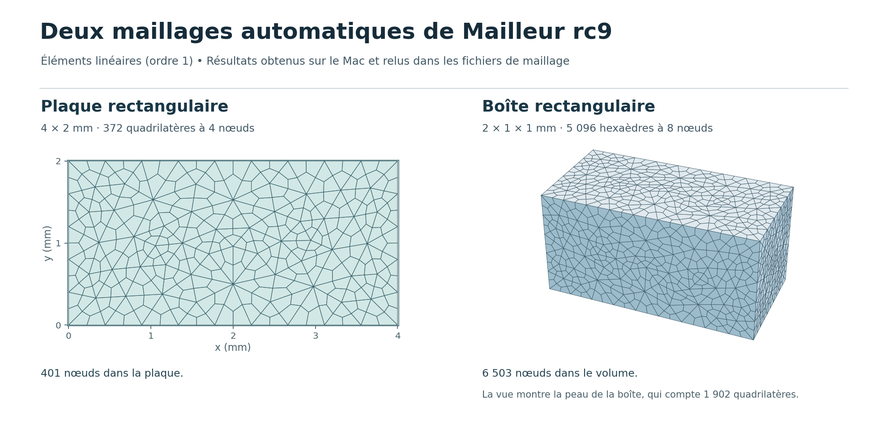

# Résultats du mailleur automatique

Sur un MacBook Pro M3 de 16 Go, la rc9 a produit les **372 quadrilatères** d’une plaque de 4 × 2 mm en **0,053 s** à l’ordre 1. Pour une boîte de 2 × 1 × 1 mm, elle a produit **5 096 hexaèdres** en **0,134 s** à l’ordre 1 et en **0,426 s** à l’ordre 2. Ce sont les médianes de huit générations par cas. La campagne d’apprentissage sur les 24 configurations du corpus a trouvé une stratégie admissible pour 18 d’entre elles. [Inventaire des géométries et des essais d’apprentissage](GEOMETRIES_ENTRAINEMENT_RC9.md)

## Temps mesurés sur le Mac

| Pièce et élément du domaine | Éléments | Nœuds | Premier appel¹ | Médiane de 8 appels² | Min – max² | Qualité minimale |
| --- | ---: | ---: | ---: | ---: | ---: | ---: |
| Plaque, quadrilatères à 4 nœuds | 372 | 401 | 0,172 s | **0,053 s** | 0,050 – 0,145 s | 0,593 |
| Plaque, quadrilatères à 8 nœuds | 372 | 1 173 | 0,060 s | **0,059 s** | 0,058 – 0,094 s | 0,593 |
| Boîte, hexaèdres à 8 nœuds | 5 096 | 6 503 | 0,144 s | **0,134 s** | 0,133 – 0,176 s | 0,195 |
| Boîte, hexaèdres à 20 nœuds | 5 096 | 24 148 | 0,427 s | **0,426 s** | 0,424 – 0,587 s | 0,195 |

¹ Le 19 novembre 2026, chaque premier appel a été effectué dans un nouveau processus Python et un dossier de travail vide. Le chronomètre couvre l’appel à `NativeSession.generate`, y compris le lancement du processus Rust, la géométrie, le maillage, les contrôles et le chargement du rapport et de l’aperçu. Le chargement initial de Python, la relecture indépendante avec meshio, l’ouverture de la fenêtre, l’export solveur et la résolution sont mesurés en dehors de cet intervalle ou exclus. Les caches de macOS sont restés actifs.

² Après un tour d’échauffement, les quatre cas ont tourné huit fois. La première position changeait à chaque tour. Chaque génération a lancé son propre processus Rust. Les 40 maillages, y compris les quatre premiers appels et les quatre échauffements, ont été relus avec meshio. Machine de mesure sous macOS 27.2.1, Python 3.12.16, Gmsh 4.15.2 et meshio 5.3.5. L’empreinte SHA-256 du noyau de la rc9 est `537eb405731ed53efc43ff07a52a20004ba5e19d7aa9d8c176937fafca3ddfd2`. [Mesures individuelles du 19 novembre](../verification/quad_hex_20261118/chronometrage_m3_20261119.json)

Les deux géométries utilisent une taille cible de 0,65 mm, une taille minimale de 0,2 mm, l’algorithme automatique, un fil de calcul et un plafond de 10 000 éléments du domaine. La génération fonctionne sans conseiller neuronal. Les nœuds sont partagés entre les cellules. Aux 5 096 hexaèdres de la boîte s’ajoutent 1 902 quadrilatères de frontière et 152 segments d’arête. L’indicateur de forme `minSICN` est le minimum mesuré sur les éléments du domaine. La précision mécanique dépend aussi de la pièce, du problème physique et d’une étude de convergence. Les temps d’autres pièces seront à mesurer avec leur taille, leurs courbures et leurs exigences de qualité. [Programme et dimensions des quatre cas](../scripts/validate_quad_hex_learning.py) · [Première campagne et rapports des maillages](../verification/quad_hex_20261118/README.md)

## Du maillage au résultat de calcul

Dans l’essai de traction Cast3M, la boîte de longueur 2 mm et de section 1 mm² reçoit une traction uniforme de 10 MPa. Avec un module de Young de 210 000 MPa, le déplacement axial prévu est de **0,0000952381 mm**. Sur le maillage à 20 nœuds par hexaèdre, Cast3M obtient **0,0000952381 mm**, **10 MPa** de contrainte axiale et une réaction de **−10 N** à l’appui pour **+10 N** de traction. Au total, cinq cas plans ou volumiques de la rc9 ont satisfait les 193 comparaisons du banc. [Valeurs calculées, valeurs théoriques et tolérances](../verification/quad_hex_20261118/solver_cast3m.json)

Pour le pilote public à 24 148 nœuds, la génération a pris **0,514 s**, l’export **0,603 s** et l’exécution de Cast3M 2026.0 **12,58 s**, avec un budget mémoire de 1 024 Mio pour Cast3M. Le pilote a passé 43 contrôles, puis 43 lors de la reprise des fichiers distribués. CalculiX 2.23 a réussi ses huit essais séparés, en mètres et en millimètres. Sur sa propre boîte à 20 nœuds par élément, il a obtenu **3 150,000089 N** pour une réaction attendue de **3 150 N**. Ces cas de traction élastique donnent des références vérifiables pour l’échange, les unités et le calcul. [Preuve du pilote Cast3M](../verification/quad_hex_20261118/solver_reference.json) · [Résultats CalculiX](../verification/quad_hex_20261118/solver_calculix.json)

## Évolution depuis la première version identifiable

Le code du **projet Rust d’origine** n’a pas été retrouvé lors de la reconstruction. La première version dont le fonctionnement est documenté est la **rc2**. La première publication du code sur GitHub correspond à la **rc7**. L’historique permet de retracer les changements fonctionnels. Aucune mesure de référence sur le programme d’origine ne permet de chiffrer une accélération par rapport à lui. [Historique du projet](../NOUVEAUTES.md) · [Première publication du code](https://github.com/ronanmaudet-sketch/mailleur/commit/fdb74a9)

| Version | Ce qui change pour l’utilisateur |
| --- | --- |
| rc2 | Le bureau Python/Qt appelle un noyau Rust, qui pilote Gmsh et OpenCASCADE. L’utilisateur prépare une géométrie, règle son maillage, puis l’exporte. |
| rc3 | La recherche essaie plusieurs réglages sur la pièce en cours, mémorise les essais, revalide une recette réutilisée et applique des critères de qualité par zone. |
| rc4 – rc5 | Les campagnes deviennent reproductibles par lots, interrompables et séparées par familles pour l’évaluation. Le modèle de corpus reçoit 128 descripteurs. Des optimisations réduisent la relecture des données et les calculs répétés. |
| rc6 – rc7 | Le catalogue d’imports et d’exports s’élargit. Un pont Windows convertit des pièces SolidWorks en STEP. Le projet adopte la GPLv3 ou ultérieure. Les unités IGES, la précision des coordonnées INP et la reprise des entraînements font l’objet de contrôles supplémentaires. Des essais sont exécutés dans Cast3M et CalculiX. |
| rc8 | Le noyau termine correctement ses appels Gmsh sous Windows. La lecture UTF-8, l’arrêt des calculs et les contrôles automatisés sur trois systèmes sont fiabilisés. [Corrections rc8](CORRECTIONS_RC8.md) |
| rc9 | La génération, l’apprentissage et l’export exigent des quadrilatères sur les surfaces et des hexaèdres dans les volumes. Le moteur contrôle les vraies cellules et leurs frontières, traite les primitives en unités SI et rétablit les correspondances périodiques après subdivision. Le remaillage local est suspendu pour préserver la partie extérieure à la sélection. [Fonctionnement détaillé](QUADRILATERES_HEXAEDRES.md) |

Deux évolutions antérieures disposent d’une comparaison directe sur les mêmes données. Entre la rc4 et la rc5, trois passages d’entraînement sur 33 010 enregistrements synthétiques sont passés de **17,428 s à 8,942 s**. La validation d’une boîte de 45 183 tétraèdres avec douze zones est passée de **282,35 ms à 115,73 ms**. Ces mesures historiques concernent ces deux opérations. Les temps de génération en hexaèdres de la rc9 figurent dans le premier tableau. [Protocole des comparaisons rc4 – rc5](OPTIMISATIONS_RC5.md)

## Capacités et limites pratiques

| Besoin | Ce qui est utilisable |
| --- | --- |
| Fournir une géométrie | Le noyau importe STEP, IGES et BREP. Il peut aussi reconstruire une peau à partir de formats de maillage reconnus. La rc9 a réussi 48 essais d’import et de remaillage sur des géométries synthétiques décentrées, à deux ordres et en unités m/mm. Pour un fichier SolidWorks natif, la passerelle exige Windows et une installation compatible. Sur le Mac, fournir le STEP exporté par le logiciel de CAO. [Essais des imports](../verification/quad_hex_20261118/direct_imports.json) · [Parcours des formats propriétaires](IMPORTS_NATIFS.md) |
| Obtenir un maillage admissible | La surface finale comporte des quadrilatères, le volume final des hexaèdres qui peuvent être déformés. Les triangles et tétraèdres intermédiaires servent à la subdivision. Les contrôles peuvent refuser la pièce pour la qualité, le budget ou la géométrie. Un STL conserve l’approximation de sa peau polygonale. [Règles de maillage](QUADRILATERES_HEXAEDRES.md) |
| Apprendre sur sa pièce | La recherche compare des réglages réellement essayés. Le Mac a exécuté le guide, la mémoire d’expérience et l’entraînement du corpus. Lancer explicitement l’apprentissage pour enrichir la mémoire. Les trois poids de démonstration restent désactivés faute de gain de sélection validé. Le placement des nœuds relève de Gmsh. [Géométries réellement utilisées](GEOMETRIES_ENTRAINEMENT_RC9.md) |
| Utiliser un logiciel de calcul | Cast3M et CalculiX ont exécuté les essais décrits plus haut. Les autres formats ont des niveaux de vérification propres. ANSYS structural et LS-DYNA acceptent ici les formes linéaires. Les versions commerciales d’Abaqus, ANSYS et Nastran restent à valider. L’utilisateur définit dans le solveur les matériaux, les chargements, les appuis et, selon le cas, les contacts et les formulations. [Matrice d’export](FORMATS.md) |
| Intégrer le mailleur dans un autre outil | L’API locale accepte le projet et, si nécessaire, un fichier de géométrie. Elle fournit un identifiant pour suivre le calcul, puis un rapport de qualité et les fichiers exportés. Les essais publiés chronomètrent la génération hors transport HTTP. [Mode d’emploi de l’API](API_UTILISATION.md) |
